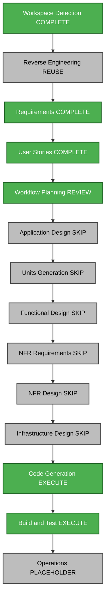

# Gia Bao portfolio execution plan

## Context, scope and impact

Requirements: ../requirements/gia-bao-requirements.md. Stories/personas: ../user-stories/stories.md and personas.md. All seven stories and three personas approved with "approve and continue".

One React/TypeScript/Vite package serves a static GitHub Pages portfolio. Replace personal data, assets and presentation; reuse existing template/layout infrastructure, typed content contracts, journal routing and previews. No backend, database, public API or hosting migration. Risk: medium, primarily attribution accuracy, broken references after cleanup, image size and accessible interaction behavior. Recovery: inspect task-specific diffs and restore only task changes if needed; preserve user edits and original Gia Bao inputs.

## Component relationships and sequence

Source resume/evidence -> src/assets and src/data -> section components and journal pages -> existing Engineering/Business shells -> App/navigation -> production bundle. Existing tests depend on these contracts. GitHub Actions and Vite retain their static base-path behavior.

| Area | Change | Priority |
| --- | --- | --- |
| src/assets, src/data | Gia Bao identity, evidence and accurate records | Critical |
| src/content/journal, project data | Two on-site case studies | Critical |
| Existing components/templates | Adapt views and suppress missing contacts | Critical |
| CSS, index.html, public | Analytics styling, metadata and favicon | Important |
| Existing tests | Replace inherited assumptions and verify visitor behavior | Critical |
| Documentation | Remove irrelevant inherited artifacts; current guidance | Important |
| Build/hosting | Preserve compatible static delivery | Preserve |

Single package, sequential updates. Assets/data precede component cleanup. No sub-agent work, cross-package release, infrastructure changes or external rollout is needed.

## Recommended stages

| Stage | Decision | Reason |
| --- | --- | --- |
| Workspace Detection | Complete | Existing code and Gia Bao sources located |
| Reverse Engineering | Reuse | Foundation suitable; refresh stale template descriptions in documentation |
| Requirements Analysis | Complete | Source-based scope and A/B/C approved |
| User Stories | Complete | Seven stories and three personas approved |
| Workflow Planning | Review pending | Concrete sequence and risk assessment prepared |
| Application Design | Skip | Changes within existing section/journal/preview boundaries |
| Units Generation | Skip | One cohesive portfolio unit |
| Functional Design | Skip | No new schemas, business rules or algorithms; reuse typed content |
| NFR Requirements | Skip | Stack fixed; existing static setup supports approved quality criteria |
| NFR Design | Skip | Existing responsive/keyboard/motion patterns suffice |
| Infrastructure Design | Skip | GitHub Pages configuration retained |
| Code Generation | Execute | Implement all seven stories; detailed plan prepared |
| Build and Test | Execute | Verify output and write required instructions |
| Operations | Placeholder | No publishing or monitoring changes |

Skipped design stages do not waive accessibility, source accuracy or verification. If new service boundaries, schemas or complex logic prove necessary, revise recommendations before expanding scope. The user may request inclusion or exclusion of stages.

## Workflow visualization

Text alternative: Workspace Detection, reused architecture context, Requirements and User Stories are complete. Workflow Planning is under review. Skip separate application/unit/functional/NFR/infrastructure design stages. Execute Code Generation planning/implementation, then Build and Test. Operations remains a placeholder.

Validation: node identifiers, quoted labels, supported node/edge/style statements and edge references checked before writing. No ASCII-art diagram is used.

## Implementation sequence and success

1. Inspect actual evidence; prepare selected browser assets and resume copy.
2. Replace typed profile, education, internship, skills, achievements and gallery records.
3. Write two source-grounded project case studies using existing journal routes.
4. Adapt current views for evidence types, Gia Bao identity and omitted contacts.
5. Apply navy/teal analytics styling, responsive layout and labeled metric callouts.
6. Remove replaced Hung assets and irrelevant personal documentation, fixing references.
7. Verify meaningful tests, production build, navigation, downloads and deletion diff.
8. Summarize implementation and pass the required final review gates.

Success: GB-01 identity/metadata; GB-02 and GB-03 accurate project detail; GB-04 preparation and experience; GB-05 inspected evidence; GB-06 accessible navigation/downloads and no empty contacts; GB-07 cleanup, docs and passing checks.

Run npm test and npm run build after locked dependency setup; check source/output for Hung identity and stale asset links. Check static base-path behavior where affected. Perform supported desktop/mobile/keyboard preview checks when available; record limits. Inspect image sizes and bundle output rather than load-test this static portfolio. Do not commit, push or deploy under this plan. No external timeline commitment.

## Extension compliance

Security Baseline: N/A, disabled by answer B. PBT: N/A, disabled by answer C. Full rule files skipped and not loaded; skips recorded in audit. No applicable enabled extension findings.

## Progress

- [x] Review approved requirements, stories and existing architecture.
- [x] Assess impact, dependencies, risks, stage decisions and sequence.
- [x] Validate diagram and include text alternative.
- [x] Prepare code-generation plan for concrete review.
- [x] Obtain explicit approval of workflow and code plan.
- [x] Execute approved implementation.
- [ ] Review implementation; complete Build and Test.

Approval of this plan and ../../construction/plans/gia-bao-portfolio-code-generation-plan.md covers the proposed implementation sequence, not unseen results or deployment.

## Superseding requested design revision

The user explicitly requested changes at Code Generation review. A single Data Atlas now replaces the retained templates, and public document downloads/wording are removed. The implementation plan amendment and current code summary are authoritative; prior implementation steps above are historical. No deployment or infrastructure migration.
